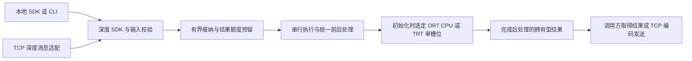

# MiniInfer V1 I-S-O 需求分析与行动计划

日期：2026-10-11；I.3 的 V2 边界于 2026-10-15 同步。范围：V1 P0。本文为实施前的需求分析快照，下文“待实施”及“本轮只交付本文档”描述原分析任务。后续 V1.1—V1.6 的实施结果、测试与实测数据以 [V1 验收记录](depth_validation.md)为准；新增 V2 完整 GPU 预处理仍待实现与实测。

**V1 的完成目标是交付一个在现有电脑与 NVIDIA GPU 上验证过的 C++ 深度推理组件：模型转换正确，调用接口明确，资源与错误可控，部署包可以重建，结果与基线可以复现。** 本地 SDK / CLI 是主交付，TCP 是远程调用与回归入口；性能优化实验在 V2 展开。

本文按 I【洞察】分析要求背后的问题，按 S【策略】确定解决顺序和工程边界，按 O【行动】给出交付物与验收关口。行动部分是后续实施清单，本轮只交付本文档。

需求依据以 [V1 / V2 主计划](MiniInfer_V1_V2_求职改进策略.md)的 V1 P0 及 V1.1—V1.6 为准；当前完成状态以 [README](../README.md)为准。工程约束参照[项目开发规范](<../MiniInfer 项目说明与 AI Agent 开发规范.md>)，复用边界参照[架构说明](architecture.md)、[D16 计划](D16_TCP_网络编程学习扩展.md)和[技术栈](tech_stack.md)。下文对接口、预算与测量方法的细化作为实施策略，具体参数在对应检查点核验、冻结。

## I【洞察】V1 要补齐哪些能力

### I.1 当前基础与版本目标

现有项目已经建立 CPU MLP、拥有型输入与结果、有界线程池、关闭处理、TCP 协议及测量方法。README 记录 D1—D15 与 D16 已完成，当前没有 GPU 后端。这些成果提供工程基础；Depth Anything V2 Small 的模型图、图像契约和设备执行仍需独立验证。[当前状态](../README.md)、[已有架构](architecture.md)

| 已有基础 | V1 可以复用的部分 | V1 必须补齐的部分 |
|---|---|---|
| 固定 MLP 的计算与参考工件 | 数据溯源、数值对照、回归方法 | 视觉模型导出、图像前后处理、深度任务保持 |
| ThreadPool、拥有型任务、关闭语义 | 有界接纳、异常传播、排空与资源回收方法 | GPU 上下文与缓冲的独占使用、设备完成边界 |
| D16 TCP 与有限连接线程 | 分帧、收发、截止时间、连接所有权、MLP 回归 | 深度消息、较大请求与响应、全局字节预算 |
| CMake / CTest 与基准记录 | 独立构建、测试组织、原始数据与复现习惯 | 可选后端依赖、外部 SDK 集成、兼容模型包和 GPU 基线 |

阅读历史文档时需要按版本区分：v0.1 的“不引入推理框架”约束不阻止 V1 接入 ORT / TensorRT；D16 的 65540 字节消息体上限不适用于新的深度消息；旧技术栈中的 15/15 测试是 D1—D15 记录，README 的 24/24 包含 D16。旧洞察、交接记录与教材拓展内容不增加 V1 的必做项。

### I.2 五项影响实施顺序的判断

**第一，V1 的价值来自交付链完整。** 一张深度可视化只能说明某条路径产生了输出。调用方还需要知道输入如何解释、输出如何使用、失败如何处理、环境如何重建。因此验收对象应覆盖模型、SDK、模型包和复现证据。可迁移的成果是部署与 C++ 集成能力。[主计划 S 1、S 2.4](MiniInfer_V1_V2_求职改进策略.md)

**第二，正确性包含不同问题，必须分层定位。** Python 与 C++ 预处理不一致会污染后续所有对比；相同输入张量下的后端误差属于转换与精度问题；去 padding 和尺寸恢复错误属于后处理问题；近远排序是否保持属于任务效果问题。将这些问题混在一张伪彩图里，无法判断误差从哪里开始。V1 应先建立中间工件，再逐段接入后端。[主计划 S 2.1、S 2.3](MiniInfer_V1_V2_求职改进策略.md)

**第三，固定模型形状仍会产生可变的服务内存成本。** 模型输入固定为 `[1,3,518,518]`，对外结果却恢复为原图尺寸。原图越大，RGB 请求和 FP32 深度响应越大。例如，假设允许 1920×1080 原图，仅 RGB8 像素就占 6,220,800 字节，FP32 深度占 8,294,400 字节，约为 5.93 MiB 与 7.91 MiB；尚未计入元数据、中间图像与编码副本。这是预算示例，不代表已支持该尺寸。队列长度有界并不足以证明整体内存有界。[主计划 S 2.4](MiniInfer_V1_V2_求职改进策略.md)

**第四，单槽位降低了并发复杂度，仍需要完整的生命周期契约。** 多个连接可以同时提出请求，但同一 TensorRT 上下文只能按 V1 约定串行使用。超时、断连或调用方停止等待之后，设备工作可能仍在执行；资源必须保存到安全完成。V1 就需要正确接纳、结果就绪和关闭语义，V2 再扩展公开异步接口和两个槽位。[主计划 S 2.2](MiniInfer_V1_V2_求职改进策略.md)

**第五，V1 的性能产出是一份可信基线。** FP16 配置需要完成并通过精度验收，实际延迟与内存需要测量；原要求没有承诺固定加速比。先区分引擎构建、启动、首请求、稳态以及模型、SDK、TCP 的不同耗时，V2 才能判断优化是否有效。单目相对深度也不能直接解释为米制距离或板端控制能力。[主计划 I 3、S 2.4](MiniInfer_V1_V2_求职改进策略.md)

### I.3 必做范围与后续边界

| 归属 | 内容 | 对 V1 验收的影响 |
|---|---|---|
| V1 P0 | Small 单模型；518 静态形状；Python、ORT CPU、TensorRT FP32 / FP16；同步 SDK；单 GPU 槽位；本地 / TCP；可重建模型包；精度与基线 | 全部通过才能完成 V1 |
| V2 P0 | 518 / 392 静态尺寸取舍；可靠异步 SDK；缓冲复用对照；1 / 2 槽位；完整 GPU 预处理及 A / B / C 路径对照；Profiler、持续过载与至少 30 分钟长稳 | V1 完成后推进，不追溯增加 V1 验收项 |
| P1 | INT8 PTQ、实时帧淘汰、epoll / eventfd、独立算子、TensorRT Plugin、ROS2 等 | 不阻塞 V1 |
| E1 | 真实 ARM / Jetson / NPU 平台适配及板端指标 | 设备到位后独立验收 |

V1 包含满队列、慢读、超时、断连和关闭的正确性测试；V2 进一步建立持续负载、资源复用与长稳实验。两者按深度递进，基础资源安全不能推迟到 V2。[主计划 S 2—S 5、O 1—O 2](MiniInfer_V1_V2_求职改进策略.md)

V2.4 必须实现、集成并验收已解码 RGB8 上传后的完整 GPU 像素预处理：除以 255、双线性缩放、补边、通道归一化、HWC→NCHW 直接连接 TRT 输入；CPU 保留校验、入口需要时的解码、几何元数据、调度与结果后处理。A 为 V1 的 CPU 黄金基线，B 为局部 GPU 对照，C 为完整 GPU 候选；沿用相同几何 / 数值及 FP32 I/O 契约，默认部署路径由精度、端到端性能和资源实测选择，无加速不等于未完成实验。具体范围以 [V2 主计划 S 3.4 / O V2.4](MiniInfer_V1_V2_求职改进策略.md)为准。

## S【策略】先对齐模型 再完成组件与交付

### S.1 固定主线与输入输出契约

实施顺序保持 **Python FP32 → ONNX / ORT C++ CPU FP32 → TensorRT FP32 → TensorRT FP16 → SDK 定型 → TCP → 部署复验**。模型契约和数据清单先于后端实现，SDK 在两种实际后端出现后抽取共同职责。

| 项目 | V1 固定要求 | 需要在实施时补全的参数 |
|---|---|---|
| 模型 | Depth Anything V2 Small，唯一新增主负载 | 仓库提交、权重来源与哈希、导出包装、opset |
| 模型输入 | Batch=1、RGB、NCHW、`[1,3,518,518]` | 输入名称、dtype、归一化常量及运算顺序 |
| 几何处理 | 等比 resize + 居中 padding | 缩放取整、奇数 padding 分配、填充值、插值与坐标规则 |
| 后处理 | 去 padding，恢复原图尺寸 | 原始输出形状、裁剪和插值顺序、尺寸映射规则 |
| 对外结果 | 拥有型 FP32 相对深度图 | 宽高、布局、近远方向、语义版本；网络字节序单独明确 |
| 精度配置 | ORT CPU FP32、TRT FP32、TRT FP16 | TF32、混合精度、实际层行为及构建选项 |
| 执行范围 | 一个 GPU 槽位；模型加载后再接收业务 | 队列容量、超时、资源限额与错误分类 |

项目选择的方形 padding 包装应成为 Python 与 C++ 的共同基准。主计划已说明官方默认几何处理与此不同，不能只设置 `input_size=518` 就假定得到相同形状；项目包装下的结果应按自身契约报告。[主计划 S 2.1—S 2.2](MiniInfer_V1_V2_求职改进策略.md)

### S.2 用最小组件隔离模型与设备职责

建议沿用现有模型无关的线程池与接纳思路，为深度输入、结果和后端建立独立类型。现有 MLP Runtime 与 TensorView 的契约保持明确；主机视图不承载设备地址。GPU 依赖通过可选构建目标接入，使 CPU 核心和 MLP 回归仍可独立构建。[技术栈扩展约束](tech_stack.md)、[v0.1 升级边界](MiniInfer_V0.1_ISO_策略.md)

这是 V1 的建议执行边界，不要求新建通用调度框架。后端在初始化时固定，不做请求级切换或热更新；ORT CPU 可显式选择，GPU 失败不能静默切换到 CPU。

SDK 对外只需模型初始化、同步推理、配置查询和关闭四类能力。内部可以复用任务与 future 实现串行接纳，同步接口仍可能明确返回队列满或关闭错误；公开可靠异步能力留到 V2 完善。

实施时固定以下生命周期规则：

1. 排队后的任务拥有其执行所需输入，或持有明确定义、受限且足够长寿命的存储；默认采用拥有型输入，避免借用调用方临时图像。
2. 同一槽位独占上下文、Stream、设备缓冲与工作内存。GPU 提交、推理完成、D2H 完成和拥有型结果可用是不同边界。
3. 返回成功意味着后处理完成且结果已独立拥有存储；后续调用或 SDK 关闭不会覆盖既有结果。
4. 建议沿用停止接纳、排空已接纳任务、等待设备安全完成、释放资源的关闭顺序；重复关闭和提交竞争应有明确结果。外部调用仍须保证 SDK 对象存活。
5. 输入错误、容量不足、模型包不匹配、引擎加载失败和执行失败分别报告。初始化部分失败应回收已创建资源；设备故障不得被计作成功或提前释放仍在使用的资源。

### S.3 建立能够定位误差的精度验收

先保存 Python 黄金工件，再用相同输入张量对照后端，最后验证完整图像链路。相邻后端对照用于定位问题，同时保留各后端相对同一 Python 基准的结果，避免误差逐级累积却只观察局部差异。

| 检查层 | 输入与比较对象 | 必须保存的证据 |
|---|---|---|
| 前处理 | 同一 RGB 图像，比较 Python / C++ 变换参数与模型输入张量 | 原图、缩放与 padding 元数据、预处理张量；横图、竖图、边缘和极端像素样例 |
| 模型执行 | 同一预处理张量，比较 Python、ORT、TRT FP32 / FP16 原始输出 | 输出形状、原始张量、误差统计与实际精度配置 |
| 后处理 | 各后端输出去 padding 并恢复原图尺寸 | 还原结果、空间对应检查及误差；可用同一原始输出单独定位还原差异 |
| 任务保持 | 独立带近远排序标注的小子集 | 有效点对、近远方向、不确定点规则、各后端排序正确率及相对 Python 的退化 |

数值报告包含 MAE、RMSE、最大与 P99 绝对误差、非有限值计数，以及 `abs(candidate-reference) > atol + rtol × abs(reference)` 的越界比例。逐图结果与汇总结果同时保留，防止平均值掩盖失败样例；原始张量比较不允许逐图缩放、平移或 min-max。伪彩色图只辅助检查。

开发 / 调参样本与最终验收样本分开，清单与标注版本可追溯。FP32 与 FP16 的容差、允许越界比例和排序退化门槛先在开发阶段论证，再于最终测试前冻结；不能直接继承 CPU MLP 的容差。最终样本不得用于反复放宽门槛，必要的规则修订应记录原因并重新保持开发与验收隔离。

部署一致性与任务效果分别下结论：无标注图片可以验证转换一致性，不能证明近远排序正确；小标注子集能够支持其覆盖范围内的任务保持判断，不能外推为米制测距精度。FP16 未通过时可暂用已通过的 FP32 继续排查，但 V1.3 与整个 V1 仍未完成。[主计划 S 2.3、O 1](MiniInfer_V1_V2_求职改进策略.md)

### S.4 将 TCP 接纳与字节预算一起设计

复用 D16 的帧边界、固定连接线程、超时与收发基础，新建 RGB8 HWC 请求和 FP32 深度响应。保留 MLP 消息语义、长度约束及回归；新增消息的类型、版本和兼容行为在实现前写明。改变既有字段语义或布局时升级协议版本，不把 MLP 的 64 维输入改解释成图像。[D16 与 V1 衔接](D16_TCP_网络编程学习扩展.md)

设原图宽高为 W、H，最低有效载荷预算为：RGB 请求 `3WH + 请求元数据`，深度响应 `4WH + 响应元数据`。帧头、变换副本、结果编码副本及后端内存另行计入；维度乘法先检查溢出。

资源控制分成两个时点：

- **接收前及接收中**：依据帧头限制消息长度，在申请消息体缓冲前核验接收预算；解析图像元数据后再核验宽高、像素数与精确长度。连接数有界仍需结合每连接接收上限计算总预算。
- **计算接纳前**：同时检查排队数量、在途输入字节和结果名额 / 字节额度。接纳成功后保留额度，直至结果交付或失败回收；慢读导致发送积压时停止继续接纳超出预算的任务。

内部预算至少分清接收缓冲、等待输入、执行临时空间、待交付结果及发送副本。调用方取得结果后的长期存储归调用方管理，不能把它算作 SDK 内部已释放前仍可复用的额度。

正常关闭保全已接纳任务的终态，发送仍受期限约束；断连或超时不等于 GPU 取消成功。服务端“发送完成”和客户端“完整解析成功”分别计数。本阶段验收结果一致、资源有界及错误路径，不扩张连接模型或引入 epoll。

### S.5 把模型包与测量方法视为正式交付

模型包需要关联以下内容：

| 工件 | 最小内容 | 交付意义 |
|---|---|---|
| 模型与配置清单 | 模型提交、权重 / ONNX 哈希、导出包装、opset、输入输出与前后处理版本 | 确定执行的是哪个模型、哪套语义 |
| 后端与环境清单 | ORT / TRT / CUDA、驱动、系统、编译器、GPU、构建选项及实际精度 | 判断兼容条件与重建范围 |
| C++ 接口和示例 | 外部程序构建方式、初始化、推理、配置查询、关闭及错误说明 | 证明组件可以被独立调用方集成 |
| 构建与缓存流程 | ONNX 到 engine 的步骤、缓存标识、加载检查、失配后的明确处理 | engine 可在记录的目标环境重新生成 |
| 黄金样例与验证材料 | 输入、中间张量、预期结果、精度门槛、检查命令、排查记录 | 重建后验证行为，定位不一致 |

缓存标识覆盖模型、前后处理及形状配置、精度、软件栈与目标硬件。引擎离线构建并按目标环境缓存，服务启动时先完成兼容检查与加载再接收请求。运行时推理不依赖 Python 服务；导出与验证阶段可以使用 Python。不得把单个桌面 engine 当作跨架构交付的全部内容。[主计划 S 2.4](MiniInfer_V1_V2_求职改进策略.md)

基线分成两个维度，避免计时口径混用：

| 维度 | 需要区分的项目 |
|---|---|
| 时间阶段 | 离线 engine 构建；进程启动到可接收请求；首个业务请求；预热后的稳态 |
| 调用层级 | 预处理张量到原始输出的直接模型执行；RGB 到拥有型深度的 SDK 全链路；TCP 客户端发送到完整响应解析的端到端 |

CPU 模型计时、GPU 设备计时与主机端到端计时分别定义；GPU 阶段不能只计 enqueue 的 CPU 耗时。TCP 建连耗时单列，图像解码、请求编码、传输、响应解析是否纳入各口径均需写清。模型与 SDK 的差值不能直接当作某一算子的耗时。

稳态统一记录 Batch=1 的 P50 / P95 / P99、成功吞吐、接纳 / 拒绝 / 失败 / 超时、主机内存与显存。每组保存硬件和运行条件、原图尺寸与序列、模型与精度、连接复用、并发 / 队列配置、预热、样本量、重复次数、百分位算法及原始数据。成功请求的延迟分布与全部请求的结局一起报告；初始化、预热和稳态的内存采样范围分开说明。

部署核验至少保留一条可复现记录，包含输入、假设、检查步骤、证据与结论。发生问题时补充定位、修复与回归；全部检查通过也可以形成合格记录，无需制造故障。

### S.6 按检查点冻结尚未确定的条件

| 待定项 | 冻结时点 | 冻结结果 |
|---|---|---|
| 实际 GPU、驱动与软件组合，Small 权重和静态导出可行性 | V1.1 | 实机记录、依赖清单、最小运行证据；历史 RTX 4080 Laptop / 约 12 GB 仅供准备 |
| 完整前后处理参数、原始输出契约、样本与标注规则 | V1.1 建立，V1.2 正式对齐前固定 | 模型契约、工件和样本清单；避免后端各自解释 |
| FP32 / FP16 数值门槛、排序退化门槛与最终测试划分 | 各配置最终验收前，最晚 V1.3 | 带版本的阈值和数据划分，不以最终结果倒推门槛 |
| SDK 输入所有权、并发调用、错误及关闭约定 | V1.4 接口定型前 | 调用契约与对应正反例 |
| 消息版本与布局、原图上限、数量 / 字节预算、超时和额度释放 | V1.5 接入前 | 协议与预算表，测试可据此判断拒绝与回收 |
| 包目录、缓存键、兼容与重建规则 | V1.3 建立引擎记录，V1.4 固定，V1.6 复验 | 可核对的模型包与重建流程 |
| 基线负载、采样范围、预热、次数及统计口径 | V1.6 正式测量前 | 测量方案与可重复执行的流程 |

这些待定项由相应阶段的证据解决，不要求在尚未验证工具链时预填版本、容差、延迟目标或资源上限。

## O【行动】按 V1.1 至 V1.6 逐项验收

### O.1 执行顺序与停止条件

每次实施一个明确子任务。上一个关口通过后再扩展下一条执行路径；发现偏差时回到最早出现差异的环节排查。下表所有项目当前均为待实施。

| 子任务 | 主要动作与交付物 | 通过条件 | 未通过时的处理 |
|---|---|---|---|
| V1.1 环境与模型契约 | 核验实机和软件组合；固定 Small 与 518 包装；建立样本 / 标注清单、Python 基线和最小 CUDA / TRT 检查；探测静态导出可行性 | Python 输出、中间工件和最小设备执行可复验；模型与几何语义明确；静态导出不存在未解释的阻塞 | 先定位环境、包装或导出问题，不直接封装完整服务；V1.2 再完成正式 ONNX 工件与 C++ 对齐 |
| V1.2 ONNX 与 ORT | 生成带哈希的静态 ONNX；完成 ORT C++ CPU 路径与统一前后处理；保存分层对照 | 预处理、原始输出及尺寸还原均通过冻结的 FP32 门槛；错误可定位；模型缺失、形状或输入错误有明确处理 | 以保存的相同输入张量区分预处理问题与图执行问题；未对齐不进入 TRT |
| V1.3 TensorRT FP32 与 FP16 | 构建 / 加载两种配置；完成单槽位设备 RAII；保存引擎环境、实际精度与 TF32；执行数值与排序验收 | 两种配置都可追溯并通过各自门槛；结果在设备与后处理完成后交付；资源生命周期和失败回收有证据 | 先对照 FP32，再定位 FP16；不以图像“看起来相近”或放宽最终门槛过关 |
| V1.4 C++ SDK | 从已有后端抽取初始化、同步推理、配置查询、关闭接口；固定模型包与错误分类；提供外部调用示例 | 示例可独立构建集成；结果寿命、并发串行化、关闭竞争及兼容失配行为清楚且通过测试；CPU / MLP 可独立构建 | 补齐接口和资源契约，保持后端已通过的精度；不扩张插件注册或公开异步范围 |
| V1.5 TCP 接入 | 增加深度请求 / 响应，固定协议与预算；接入同一 SDK；保留 D16 / MLP 回归 | 同图、同配置的本地 / TCP 结果一致；满队列、超大或非法输入、半帧、断连、超时、慢读和关闭下的额度与资源回收正确 | 按接收、接纳、执行、发送分段定位；不靠无限排队、静默丢请求或提前释放缓冲解决 |
| V1.6 部署交付 | 完成构建 / 启动 / 首请求 / 稳态测量；整理模型包、版本、精度和基线报告；从干净构建目录按交付流程复现 | 在记录的兼容环境中可重建、运行并通过黄金回归；外部示例和本地 / TCP 可复验；部署核验记录与原始数据齐全；V1.1—V1.5 均已通过 | 明确缺失的是环境、功能还是证据；保持未完成状态，不以只在原开发目录运行替代重建 |

### O.2 交付组织

实施材料按三份主文档与对应工件组织，目录名称可在实施时定下，不必现在创建空文件。

| 主文档或工件 | 内容来源 | 验收时回答的问题 |
|---|---|---|
| 部署与模型契约 | V1.1、V1.4、V1.5、V1.6 | 输入输出是什么；接口如何用；如何接纳、报错、关闭、检查兼容及重建 |
| 精度报告 | V1.2、V1.3 | 各阶段在哪里对齐；FP32 / FP16 是否通过；排序退化和失败样例如何解释 |
| 性能与资源基线报告 | V1.6 | 构建、启动、首请求、稳态各花费多少；模型、SDK、TCP 的口径有何区别；资源与失败如何统计 |
| 模型包、黄金样例和原始证据 | 全阶段逐步积累 | 第三方是否能依据提交、哈希、配置、命令、原始输出与日志复验结论 |

已有 CPU / D16 数据继续作为对应阶段的历史证据；新基线独立标注模型、环境与配置。未来 V2 的比较使用 V1 深度模型基线，避免把 MLP 与深度模型的性能数字直接算作升级收益。

### O.3 V1 完成清单

- [ ] Small、518 静态形状、RGB 与相对深度语义已固定，Python 基线、数据划分和模型工件可追溯。
- [ ] ORT C++ CPU FP32、TRT FP32、TRT FP16 的前后处理、原始输出及尺寸还原通过验收，实际精度配置有记录。
- [ ] 独立标注子集的近远排序保持通过冻结门槛；完整误差统计、失败样例及适用范围已保存。
- [ ] SDK 可由外部 C++ 示例集成；结果所有权、单槽位串行执行、错误、超时与关闭契约通过相关测试。
- [ ] TCP 深度消息、本地 / 远程一致性、数量与字节上限、慢读和失败回收通过；CPU / MLP / D16 回归保留并通过相关检查。
- [ ] 模型包能在记录的兼容环境中重建和运行，缓存失配可解释，运行时推理不依赖 Python 服务。
- [ ] 构建、启动、首请求、稳态以及直接模型 / SDK / TCP 的计时和内存口径明确，原始数据与复现流程完整。
- [ ] 至少一份部署核验 / 排查记录可复现，全部 V1 P0 证据齐全，才将状态更新为 V1 完成。

### O.4 投入与下一入口

沿用主计划的 V1 **50—80 小时有效工作量**粗估；该数字尚未由 V1 开发记录验证。V1.1 完成后，依据工具链、导出与数据准备的实际情况修订。范围控制优先保持一个模型、一种静态形状、一个 GPU 槽位和既有 TCP 结构，不删除精度、资源安全或可重建要求来换取完成状态。

下一实施入口是 **V1.1 环境与模型契约**，其交付是明确可用环境、固定模型契约和可复验的最小基线。本文完成需求分析与行动规划，不启动任何实现。
