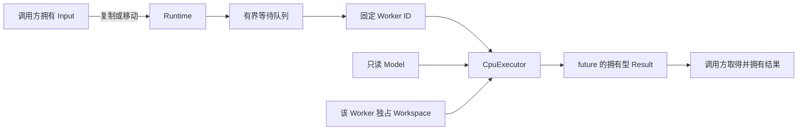

# MiniInfer v0.1 架构与契约

2026-10-10。固定 CPU FP32 MLP `64→128→10`，C++17 / Linux；当前实现不包含 GPU 后端。测试、基准和复现入口见 [README](../README.md) 与 [benchmark](benchmark.md)。

## 数据流与所有权

| 对象 | 所有者与寿命 | 并发规则 |
|---|---|---|
| 权重 / 偏置 | Runtime 的 MlpModel；加载完成后发布 | Worker 只读，发布后不移动 |
| Input | 调用者最初拥有；submit 左值深拷贝、右值移动到任务 | 异步任务不借用调用者视图 |
| Workspace | Runtime 按稳定 Worker ID 分配，默认每份 128 KiB | 单个 Worker 独占写入，隐藏层复用 |
| Result | future 交付独立 logits 和 labels 存储 | 后续任务及 Runtime 析构不覆盖旧结果 |
| TensorView | 不拥有资源，只借用上述所有者 | 使用期间所有者必须存活；主机可解引用地址 |

Runtime 成员顺序为 model、config、workspaces、pool。C++ 逆序析构使 pool 首先 drain / join，再销毁 Workspace 与 Model。调用者负责 Runtime 对象自身的寿命：可以并发 submit / run / shutdown，不能让析构与仍在访问该对象的外部调用重叠。

CpuExecutor 无队列和线程状态，执行 `Linear → ReLU → Linear → Argmax`。W1 / W2 为 `[out,in]` 行主序；Linear 按输入顺序 FP32 累加后加 bias，argmax 并列取最小索引。数据加载与数值细节见 [数据契约](../data/README.md)。

## 接收、执行与关闭

BoundedQueue 使用预分配的 `vector<optional<Task>>` 环形槽位，以及一个 mutex / condition_variable。容量只计等待任务，执行中的任务已经出队；不限制调用者长期保存的结果数量。

1. submit 在调用线程校验输入并构造拥有型任务与 future。
2. 同一队列锁内检查 closed、检查容量、放入任务。关闭优先于满队列；满时立即 QueueFull，关闭时立即 PoolClosed。拒绝不会返回可用 future。
3. Worker 出队后释放队列锁，使用自己的 Workspace 执行。packaged_task 将计算异常存入对应 future，Worker 后续仍可工作。
4. shutdown 关闭接收、唤醒 Worker；Worker 排空等待任务后退出，shutdown 在队列锁外 join。单独的 shutdown mutex 序列化多个关闭调用。

状态按 `Running → Draining → Stopped` 演进，由队列接收标志及 join 完成表示。重复关闭安全；Runtime 的同步 run 等价于 submit().get()，因此也可能因队列满而拒绝。同池 Worker 不等待同池任务、不销毁池、不自 shutdown；自 shutdown 抛 logic_error，避免 self-join。

ThreadPool 保持模型无关，任务参数仅为 Worker ID。第三个可选构造参数 ThreadFactory 用于可控测试，默认创建 std::thread。工厂应执行传入入口并返回其 joinable 线程，不能 detach；返回非 joinable 线程被拒绝。线程启动失败时关闭队列、join 已启动线程再传播原异常。测试在第 0、2 个线程处注入 system_error，验证线程与工厂捕获资源已回收。

## 可选计时接口

`Runtime::submit(input, shared_ptr<TaskTiming>)` 和 `ThreadPool::submit(callable, timing)` 支持可选记录，普通调用不创建记录或读取时钟。每次请求必须使用独立记录；多个请求不能并发复用同一记录。调用方只能在对应 future 的 wait / get 确认完成后读取，不允许执行中无同步读取。

接收入队时间由 noexcept hook 在队列锁内、接受后、Worker 可出队前写入；开始和结束时间由 Worker 写入。结束时间通过作用域守卫在成功返回及异常退出时记录，发生在 packaged_task 发布完成之前。future 的同步建立写入与读取间的可见性。

benchmark_cli 另记调用前、submit 返回和 get 取得结果时间。排队为 start−enqueued，执行为 finish−start，完成为 finish−call_before，回收为 acquired−finish，端到端为 acquired−call_before。提交耗时不是排队时间。数据包含记录时钟及 future 等开销；具体负载与百分位口径见基准报告。

## 验证与扩展边界

四生产者在 1/2/4 Worker 下各完成 40 个压力请求，混合 Batch 1/8/32/64/256，成功结果逐元素对照直接执行器；饱和拒绝单独统计，future 窗口每生产者最多 2。保留结果、溢出异常与恢复另行验证。关闭测试使用 gate / promise 控制执行与队列状态，包含竞争、关闭优先级、恰好一次执行及构造失败回收。异常退栈先释放 gate、join 线程，再销毁被捕获的对象。

测试中的关闭守卫在 gate 释放后、调用线程 join 前停止接收，避免部分调用线程启动失败时重试的生产者永远等不到关闭；显式异常注入覆盖该退栈分支。ASan / UBSan 与 TSan 采用互斥配置。本机 GCC TSan 默认地址布局曾启动失败，使用 `setarch x86_64 -R` 后五项相关测试通过，退栈分支另做 TSan 复验；这只是已运行路径的证据。具体日志与复现命令在 README。

未来增加设备存储、Stream / Event 或真实模型执行适配时，应保留拥有型输入 / 结果及实际完成后交付 future 的语义。主机 TensorView 不承载 GPU 地址，多 CPU Worker 测试不证明 GPU 资源共享安全；当前不预建空的 GPU 类或通用后端注册器。
