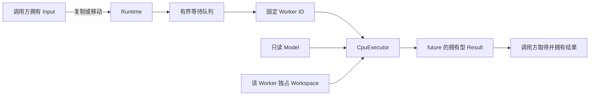

# MiniInfer v0.1 架构与契约

本文主体为 2026-10-11 的 v0.1 / D16 历史架构快照：固定 CPU FP32 MLP `64→128→10`，C++17 / Linux；该快照没有 GPU 后端。下文主体中的“当前 / 未来”以此快照为范围；末节单列后续版本计划。实际进度、测试与复现入口以 [README](../README.md)及对应验收记录为准，历史基准见 [benchmark](benchmark.md)。

## 数据流与所有权



| 对象 | 所有者与寿命 | 并发规则 |
|---|---|---|
| 权重 / 偏置 | Runtime 的 MlpModel；加载完成后发布 | Worker 只读，发布后不移动 |
| Input | 调用者最初拥有；submit 左值深拷贝、右值移动到任务 | 异步任务不借用调用者视图 |
| Workspace | Runtime 按稳定 Worker ID 分配，默认每份 128 KiB | 单个 Worker 独占写入，隐藏层复用 |
| Result | future 交付独立 logits 和 labels 存储 | 后续任务及 Runtime 析构不覆盖旧结果 |
| TensorView | 不拥有资源，只借用上述所有者 | 使用期间所有者必须存活；主机可解引用地址 |

Runtime 成员顺序为 model、config、workspaces、pool。C++ 逆序析构使 pool 首先 drain / join，再销毁 Workspace 与 Model。调用者负责 Runtime 对象自身的寿命：可以并发 submit / run / shutdown，不能让析构与仍在访问该对象的外部调用重叠。

CpuExecutor 无队列和线程状态，执行 `Linear → ReLU → Linear → Argmax`。W1 / W2 为 `[out,in]` 行主序；Linear 按输入顺序 FP32 累加后加 bias，argmax 并列取最小索引。数据加载与数值细节见 [数据契约](../data/README.md)。

## 接收、执行与关闭

BoundedQueue 使用预分配的 `vector<optional<Task>>` 环形槽位，以及一个 mutex / condition_variable。容量只计等待任务，执行中的任务已经出队；不限制调用者长期保存的结果数量。

1. submit 在调用线程校验输入并构造拥有型任务与 future。
2. 同一队列锁内检查 closed、检查容量、放入任务。关闭优先于满队列；满时立即 QueueFull，关闭时立即 PoolClosed。拒绝不会返回可用 future。
3. Worker 出队后释放队列锁，使用自己的 Workspace 执行。packaged_task 将计算异常存入对应 future，Worker 后续仍可工作。
4. shutdown 关闭接收、唤醒 Worker；Worker 排空等待任务后退出，shutdown 在队列锁外 join。单独的 shutdown mutex 序列化多个关闭调用。

状态按 `Running → Draining → Stopped` 演进，由队列接收标志及 join 完成表示。重复关闭安全；Runtime 的同步 run 等价于 submit().get()，因此也可能因队列满而拒绝。同池 Worker 不等待同池任务、不销毁池、不自 shutdown；自 shutdown 抛 logic_error，避免 self-join。

ThreadPool 保持模型无关，任务参数仅为 Worker ID。第三个可选构造参数 ThreadFactory 用于可控测试，默认创建 std::thread。工厂应执行传入入口并返回其 joinable 线程，不能 detach；返回非 joinable 线程被拒绝。线程启动失败时关闭队列、join 已启动线程再传播原异常。测试在第 0、2 个线程处注入 system_error，验证线程与工厂捕获资源已回收。

## 可选计时接口

`Runtime::submit(input, shared_ptr<TaskTiming>)` 和 `ThreadPool::submit(callable, timing)` 支持可选记录，普通调用不创建记录或读取时钟。每次请求必须使用独立记录；多个请求不能并发复用同一记录。调用方只能在对应 future 的 wait / get 确认完成后读取，不允许执行中无同步读取。

接收入队时间由 noexcept hook 在队列锁内、接受后、Worker 可出队前写入；开始和结束时间由 Worker 写入。结束时间通过作用域守卫在成功返回及异常退出时记录，发生在 packaged_task 发布完成之前。future 的同步建立写入与读取间的可见性。

benchmark_cli 另记调用前、submit 返回和 get 取得结果时间。排队为 start−enqueued，执行为 finish−start，完成为 finish−call_before，回收为 acquired−finish，端到端为 acquired−call_before。提交耗时不是排队时间。数据包含记录时钟及 future 等开销；具体负载与百分位口径见基准报告。

## 验证与扩展边界

四生产者在 1/2/4 Worker 下各完成 40 个压力请求，混合 Batch 1/8/32/64/256，成功结果逐元素对照直接执行器；饱和拒绝单独统计，future 窗口每生产者最多 2。保留结果、溢出异常与恢复另行验证。关闭测试使用 gate / promise 控制执行与队列状态，包含竞争、关闭优先级、恰好一次执行及构造失败回收。异常退栈先释放 gate、join 线程，再销毁被捕获的对象。

测试中的关闭守卫在 gate 释放后、调用线程 join 前停止接收，避免部分调用线程启动失败时重试的生产者永远等不到关闭；显式异常注入覆盖该退栈分支。ASan / UBSan 与 TSan 采用互斥配置。本机 GCC TSan 默认地址布局曾启动失败，使用 `setarch x86_64 -R` 后五项相关测试通过，退栈分支另做 TSan 复验；这只是已运行路径的证据。具体日志与复现命令在 README。

未来增加设备存储、Stream / Event 或真实模型执行适配时，应保留拥有型输入 / 结果及实际完成后交付 future 的语义。主机 TensorView 不承载 GPU 地址，多 CPU Worker 测试不证明 GPU 资源共享安全；当前不预建空的 GPU 类或通用后端注册器。

## D16 网络层

`miniinfer_net` 依赖 `miniinfer_core`，核心库不反向依赖网络。`infer_server` 启动时只加载一次模型，连接线程调用 `Runtime::run()`；推理 Worker 不执行 socket I/O。`tcp_echo_server/client` 共用相同的协议及收发实现。

```text
接入线程 / 唯一 listener fd
  → 连接线程保留槽（默认 4） + 等待连接队列（默认 8）
  → serve_connection：整帧接收 / 校验 / 解码拥有型 MlpInput
  → Runtime::run：有界推理队列 → Worker 私有 Workspace
  → 拥有型 MlpResult → 编码 / 限时发送 → 读取下一帧
```

`UniqueFd` 不可复制，移动后源对象为空；Linux close 不重试 EINTR。接入层通过移动交接 fd，活跃 fd 仅由其连接线程关闭；监听 fd 仅由接入线程关闭，避免跨线程关闭后 fd 号码复用。停止时可直接回收尚未交接的等待 fd。`TcpServer` 构造启动固定线程，部分启动失败会停止并 join 已创建线程；析构重复执行 shutdown。

线程槽在分配连接时即计为 active，因此 `active <= connection_threads`、`pending <= waiting_connections`。等待队列满立即关闭新连接，此时尚未读取业务请求，不保证错误帧；内核 listen backlog 是独立、有限的内核队列，不计入应用层统计。等待期限从接入计时，在出队时检查过期。每连接至多一个计算/回包请求，收发缓冲及结果都归连接线程所有，完成一次后才读下一帧；不支持流水线调度、乱序回包或重试。

帧头逐字段编码，整数和 IEEE 754 FP32 位模式统一大端。全局 65540 字节消息体上限在分配前验证，随后校验类型对应长度、Batch、有限浮点数及 labels。ID 在连接内严格递增，客户端验证响应 ID、类型与 Batch。`recv_exact`/`send_all` 使用 `MSG_DONTWAIT`，EAGAIN 时 poll，EINTR 后重新检查同一绝对截止时间；帧头/消息体共享读截止，整帧编码后共享写截止。poll 最多等待 20ms 以观察停止。发送使用 `MSG_NOSIGNAL`。`IoHooks` 仅用于确定性 syscall/时钟注入测试，生产默认调用 Linux API。

关闭由 main 在创建任何 Worker 前屏蔽 SIGINT/SIGTERM，再通过 `sigtimedwait` 同步接收通知，无异步信号 handler 执行锁操作。`TcpServer::shutdown()` 停止接入、清等待队列并通知接收停止，join 接入线程，无锁调用 Runtime drain，再 join 连接线程。已经运行或排队的推理继续完成，回包不被停止标志取消，但仍受写期限限制；断连后仅记录失败并回收。空闲/半帧连接不再提交业务。停止检查与 `Runtime::run()` 调用存在窄竞争窗口，Runtime 的队列关闭是最终接收边界：关闭前已接受者完成，晚到提交抛 `PoolClosed` 并映射 `SHUTTING_DOWN`。测试用 gate 明确覆盖该窗口。

`run` 与 `drain` 回调可能并发，捕获的 Runtime 必须比 TcpServer 存活久；不允许回调自 shutdown。重复、并发 shutdown 只执行一次 drain，其他调用等待相同完成边界。计算排空没有硬性时间保证。`snapshot` / `wait_for_stats` 在 mutex 下访问资源计数，业务/IO计数在会话结束时聚合；`responses` 表示服务端发送完成，不能代表客户端已收到。客户端独立统计成功、业务错误、协议/连接错误、超时、未尝试请求及建连错误。

## 视觉版本范围与实现入口

- V1 以 Depth Anything V2 Small 为负载，新增 RGB / FP32 相对深度契约；完成 Python / ORT / TensorRT FP32 / FP16 精度对照，交付 C++ SDK、模型包、本地 / TCP 入口。单 GPU 槽位，稠密响应纳入数量与字节预算，engine 按目标环境构建与检查。
- V2 P0 增加两种静态尺寸 / FP32 / FP16 取舍、可靠异步 SDK 与缓冲复用；按 1 / 2 槽位隔离上下文、Stream / Event、设备输入输出及 scratch，完整 GPU 路径另有每槽独立且有界的原图 RGB8 上传缓冲与所需 Pinned Memory，按原图上限及槽位数预算，不能按模型输入尺寸估算。有界 FIFO 规定出队顺序，完成可乱序并按 request_id 关联；H2D → GPU 预处理 → TensorRT → D2H → CPU 后处理遵守依赖，同 Stream 或 Event 衔接；结果进入独立拥有的存储后交付，异步使用安全结束后才复用或释放槽位资源。
- V2.4 P0 必须实现、集成并验收完整 GPU 预处理：上传已解码 RGB8，由 GPU 完成除以 255、双线性 resize、padding、通道归一化及 HWC→NCHW，直接写入同槽位 TRT 输入，避免重复上传。CPU 保留校验、入口需要时的解码、几何元数据、调度与结果后处理；数值与几何契约沿用 CPU 参考，现有混合 FP16 engine 仍为 FP32 I/O。保留 A（完整 CPU）、B（CPU 除以 255 / resize / padding，GPU 归一化 / 布局）、C（完整 GPU）三路径对照，以全模型正确性、微基准、端到端和 Profiler 验收，并覆盖资源上限、过载与长稳。默认部署按实测选择，不要求 C 更快；B / C均已实现，基础/融合kernel及独立槽位证据见 [V2升级报告](depth_v2_upgrade.md)；完成状态由其验收表确认。
- INT8 PTQ、实时帧策略、独立 LayerNorm / GEMM、TensorRT Plugin、epoll / eventfd 与 ROS2 等为 P1。量化若选做需验证真实 INT8 覆盖；实时帧若选做需明确淘汰 / 超期终态、结果年龄及发布顺序，不改变默认可靠请求语义。
- 当前只有电脑和 NVIDIA GPU，真实端侧适配单列 E1；P1 / E1 均不阻塞 P0。若实施 P1 epoll，仍要求 I/O 不等待 GPU / future、有界完成队列、连接代次和安全关闭。

协议与网络验收见 [D16 计划与记录](D16_TCP_网络编程学习扩展.md)，主题“MiniInfer：C++ 视觉模型部署与推理性能优化”的部署组件、异步资源管理和性能实验见 [V1 / V2 计划](MiniInfer_V1_V2_求职改进策略.md)。本节按该计划 2026-10-15 的 S3.3 / S3.4 / O V2.4 修订同步；计划不代表已实现成果，实际完成状态见 README。
